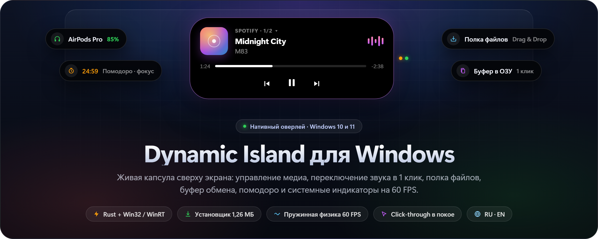
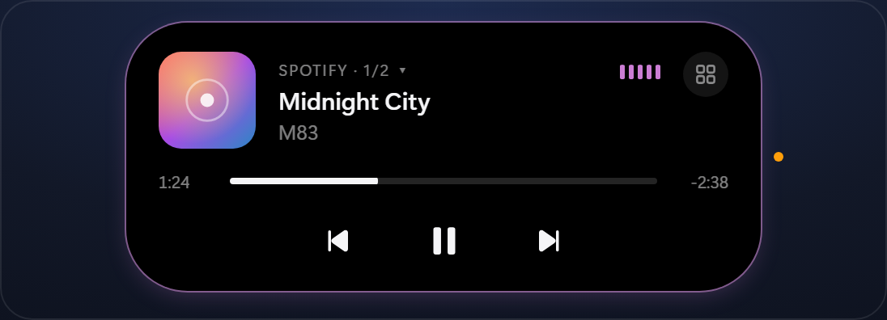
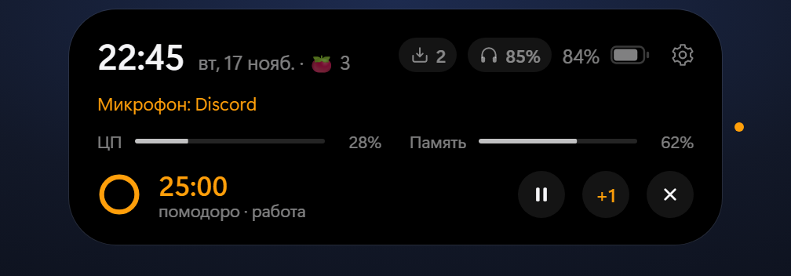
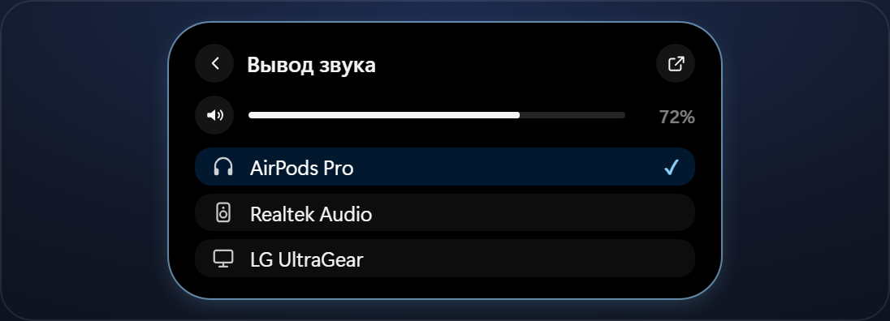
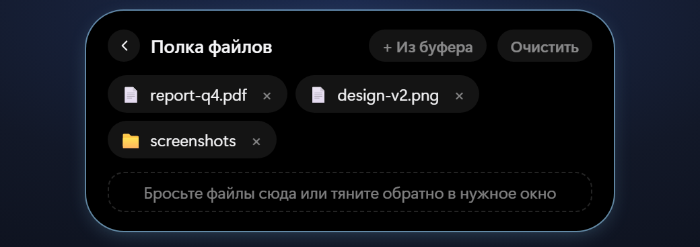
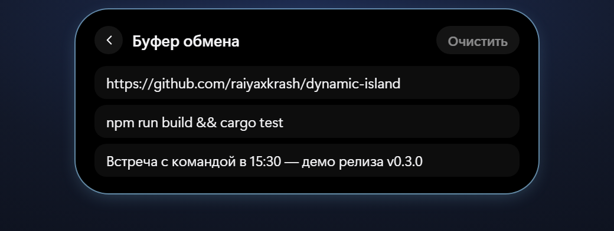
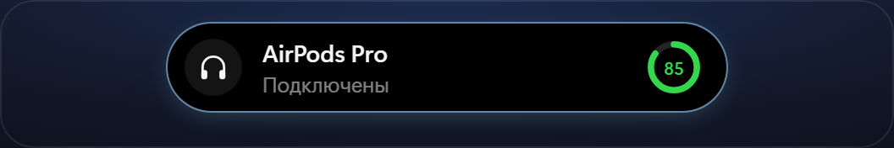
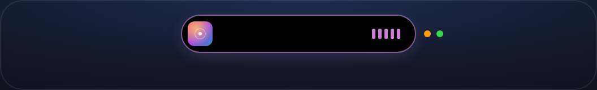
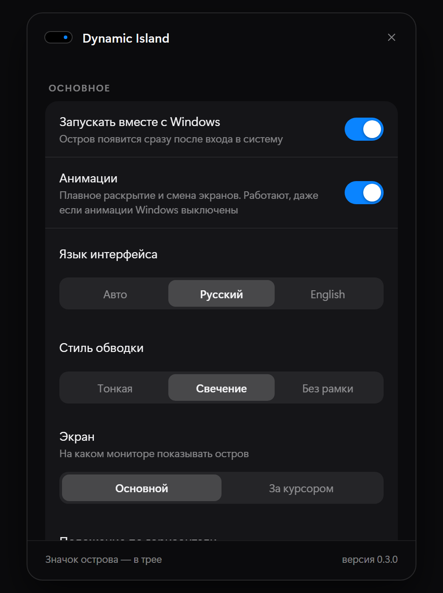
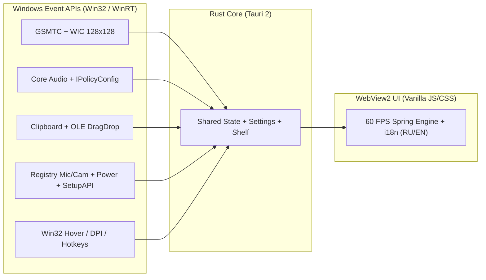

<div align="center">



<br>

[](https://github.com/raiyaxkrash/dynamic-island/releases/latest)
[-0078D4?style=flat-square&logo=windows&logoColor=white)](https://github.com/raiyaxkrash/dynamic-island/releases/latest)
[](https://github.com/raiyaxkrash/dynamic-island/releases/latest)
[](https://tauri.app/)
[](https://www.rust-lang.org/)
[](LICENSE)

<p align="center">
  <a href="README.md">🇷🇺 Русский</a> &nbsp;·&nbsp; <b>🇬🇧 English</b>
</p>

<p align="center">
  <a href="#install">Download</a> &nbsp;•&nbsp;
  <a href="#showcase">Showcase</a> &nbsp;•&nbsp;
  <a href="#features">Features</a> &nbsp;•&nbsp;
  <a href="#controls">Shortcuts &amp; Gestures</a> &nbsp;•&nbsp;
  <a href="#architecture">Architecture</a> &nbsp;•&nbsp;
  <a href="#build">Build</a>
</p>

<a href="https://github.com/raiyaxkrash/dynamic-island/releases/latest/download/Dynamic-Island-0.5.1-x64-setup.exe"></a>&nbsp;&nbsp;<a href="https://github.com/raiyaxkrash/dynamic-island/releases/latest/download/dynamic-island-0.5.1-x64-portable.exe"></a>

</div>

<br>

<table>
  <tr>
    <td width="25%" valign="top">
      <b>⚡ Event-Driven Rust Core</b><br>
      <sub>Zero wasteful polling: <code>GSMTC</code>, <code>Core Audio</code>, Registry, and Power notifications wake the UI strictly on OS events.</sub>
    </td>
    <td width="25%" valign="top">
      <b>🪶 1.26 MB &amp; Click-Through</b><br>
      <sub>Native WebView2 + Rust with no heavy Electron runtime. Passes mouse clicks through when collapsed (<code>WS_EX_TRANSPARENT</code>) and hides in fullscreen games.</sub>
    </td>
    <td width="25%" valign="top">
      <b>🌊 60 FPS Spring Physics</b><br>
      <sub>Damped spring solver preserves momentum across mid-flight interrupts — stays smooth even when Windows system animations are disabled.</sub>
    </td>
    <td width="25%" valign="top">
      <b>🔒 Privacy by Default</b><br>
      <sub>Clipboard history lives strictly in RAM and respects password-manager exclusion flags. Zero telemetry, 100% local.</sub>
    </td>
  </tr>
</table>

---

<a id="showcase"></a>

## ✨ Interface Showcase

<table>
  <tr>
    <td width="50%" align="center" valign="top">
      
      <br>
      <b>🎵 Live Media Player &amp; Adaptive Glow</b><br>
      <sub>Album-art-tinted equalizer &amp; border glow, scrubbable timeline, and multi-player session switching (<code>1/2 ▾</code>).</sub>
    </td>
    <td width="50%" align="center" valign="top">
      
      <br>
      <b>🏠 Home Hub, Pomodoro &amp; System Telemetry</b><br>
      <sub>Clock, focus counter (<code>🍅</code>), quick chips for clipboard, shelf &amp; audio, mic/cam status, CPU/RAM meters, and timer.</sub>
    </td>
  </tr>
  <tr>
    <td width="50%" align="center" valign="top">
      
      <br>
      <b>🎧 1-Click Audio Output Switcher &amp; Mute</b><br>
      <sub>Switch default playback between headphones, speakers, and displays instantly via <code>IPolicyConfig</code>.</sub>
    </td>
    <td width="50%" align="center" valign="top">
      
      <br>
      <b>📂 File Shelf (Native OLE Drag &amp; Drop)</b><br>
      <sub>Drop files onto the island or paste from clipboard, click to reveal in Explorer, and drag back out into any app.</sub>
    </td>
  </tr>
  <tr>
    <td width="50%" align="center" valign="top">
      
      <br>
      <b>📋 Quick RAM Clipboard History</b><br>
      <sub>Keep your last 6 copied text snippets 1 click away in volatile memory — never written to disk.</sub>
    </td>
    <td width="50%" align="center" valign="top">
      
      
      <br>
      <b>🔋 Bluetooth Battery &amp; Compact Pill</b><br>
      <sub>Headset battery ring on connect and sleek collapsed pill with live microphone (🟠) and camera (🟢) indicators.</sub>
    </td>
  </tr>
</table>

<details>
<summary><b>⚙️ View Settings Studio (v0.5.0 — 4 Tabs)</b></summary>
<br>
<div align="center">
  
  <p><sub>Autostart, language (Auto / RU / EN), border style (Subtle / Glow / Frameless), monitor &amp; alignment, top margin, Pomodoro quiet mode, interactive hotkey recorder, and 30-day focus stats.</sub></p>
</div>
</details>

---

<a id="features"></a>

## 🚀 Key Features

- **Media & Audio Control:** Works with Spotify, Apple Music, Tidal, YouTube/browsers, mpv, PotPlayer, and any Windows GSMTC source. Downscales cover art in Rust via WIC (`128×128`), switches default audio endpoints in 1 click (`IPolicyConfig`), and toggles Mute on middle-click.
- **Persistent File Shelf:** Drop files onto the island or click `+ Paste` (`CF_HDROP`), reveal items in File Explorer (`SHOpenFolderAndSelectItems`), or drag them out via native Windows OLE `DoDragDrop`.
- **RAM-Only Clipboard History:** Stores up to 6 recent text clips in memory while strictly ignoring password manager entries (`ExcludeClipboardContentFromMonitorProcessing`, `CanIncludeInClipboardHistory = 0`).
- **Focus Timer, Pomodoro & Quiet Mode (`🌙`):** Presets (`5m`, `15m`, `Pomodoro 25`), custom `1–180m` timer, timer state persistence across restarts, manual/automatic DND during focus work, and 30-day streak statistics.
- **System & Privacy Indicators:** Real-time microphone & camera dots (`RegNotifyChangeKeyValue`), Bluetooth headset battery (`SetupAPI`), laptop battery time remaining, RAM usage in GB, and `15+` keyboard layouts + `Caps Lock`.
- **Multi-Monitor & Smart Top-Edge Behavior:** Collapses into a 5px sliver over maximized browser tabs (`topbusy` checks exact island span for Left / Center / Right alignment) and handles per-monitor mixed DPI seamlessly.

---

<a id="controls"></a>

## ⌨️ Shortcuts & Gestures

| Action | Shortcut / Gesture |
| :--- | :--- |
| **Expand / collapse island** | <kbd>Ctrl</kbd> + <kbd>Alt</kbd> + <kbd>I</kbd> *(customizable)* or cursor hover |
| **Start Pomodoro 25 / pause timer** | <kbd>Ctrl</kbd> + <kbd>Alt</kbd> + <kbd>T</kbd> *(customizable)* |
| **Adjust system volume** | **Mouse wheel** over the island *(optionally while collapsed too)* |
| **Toggle Mute** | **Middle-click** on the island or click `🔇` in the Audio panel |
| **Next / previous track** | Two-finger **horizontal touchpad swipe** or player buttons |
| **Play / pause media** | **Double-click** album cover or track title |
| **Reveal shelf file in Explorer** | **Single-click** file chip on the Shelf *(drag to drop into apps)* |

---

<a id="install"></a>

## 📦 Installation

1. Grab the latest release from [GitHub Releases](https://github.com/raiyaxkrash/dynamic-island/releases/latest) (`Dynamic-Island-0.5.1-x64-setup.exe` or portable `.exe`).
2. Launch **Dynamic Island** — the pill appears at the top of your screen and its icon lives in the Windows system tray (left-click the tray icon to open **Settings**; the UI automatically switches to **English** on English Windows systems).

> [!NOTE]
> **Windows SmartScreen:** Because the binary is not yet signed with a paid Authenticode certificate, Windows may display *"Windows protected your PC"* on first launch. Click **More info → Run anyway**, or build from source below.

---

<a id="architecture"></a>

## 🧩 Architecture



---

<a id="build"></a>

## 🛠️ Build from Source

Requires **Node.js 20+** and **Rust** (`stable-x86_64-pc-windows-msvc`).

```bash
git clone https://github.com/raiyaxkrash/dynamic-island.git
cd dynamic-island
npm install

npm run dev      # run in development mode
npm run build    # build optimized release exe + NSIS installer
```

---

<div align="center">

Licensed under **[MIT](LICENSE)** &nbsp;·&nbsp; Crafted with **Rust + Tauri 2**

</div>
