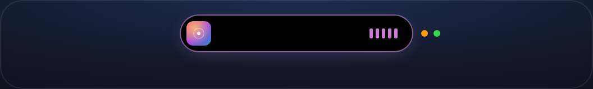
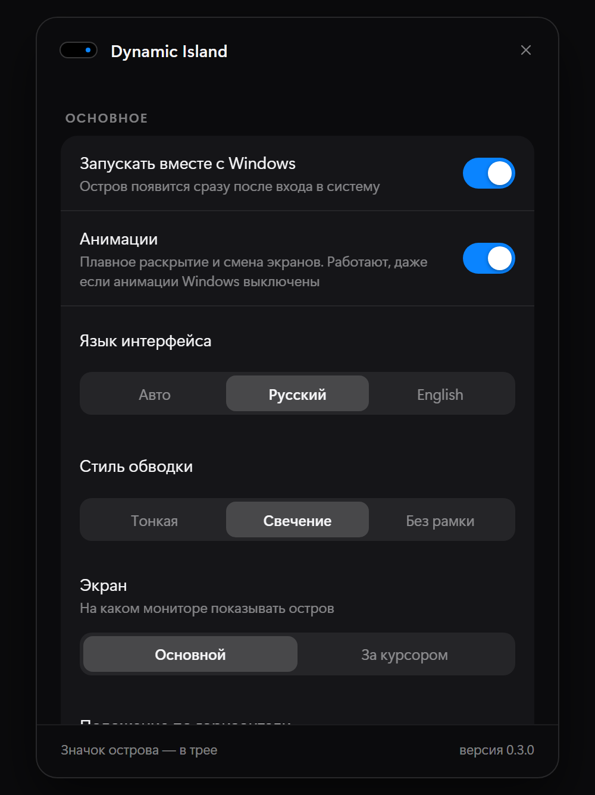
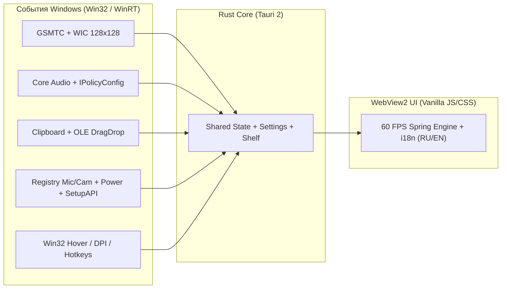

<div align="center">


<br>

[](https://github.com/raiyaxkrash/dynamic-island/releases/latest)
[-0078D4?style=flat-square&logo=windows&logoColor=white)](https://github.com/raiyaxkrash/dynamic-island/releases/latest)
[](https://github.com/raiyaxkrash/dynamic-island/releases/latest)
[](https://tauri.app/)
[](https://www.rust-lang.org/)
[](LICENSE)

<p align="center">
  <b>🇷🇺 Русский</b> &nbsp;·&nbsp; <a href="README.en.md">🇬🇧 English</a>
</p>

<p align="center">
  <a href="#install">Скачать</a> &nbsp;•&nbsp;
  <a href="#showcase">Интерфейс</a> &nbsp;•&nbsp;
  <a href="#features">Возможности</a> &nbsp;•&nbsp;
  <a href="#controls">Жесты и клавиши</a> &nbsp;•&nbsp;
  <a href="#architecture">Архитектура</a> &nbsp;•&nbsp;
  <a href="#build">Сборка</a>
</p>

<a href="https://github.com/raiyaxkrash/dynamic-island/releases/latest/download/Dynamic-Island-0.7.0-x64-setup.exe"></a>&nbsp;&nbsp;<a href="https://github.com/raiyaxkrash/dynamic-island/releases/latest/download/dynamic-island-0.7.0-x64-portable.exe"></a>

</div>

<br>

<table>
  <tr>
    <td width="25%" valign="top">
      <b>⚡ Событийный Rust-бэкенд</b><br>
      <sub>Ноль холостых опросов: <code>GSMTC</code>, <code>Core Audio</code>, реестр и питание будят интерфейс только по событию Windows.</sub>
    </td>
    <td width="25%" valign="top">
      <b>🪶 Невесомый и прозрачный</b><br>
      <sub>Установщик весит <b>1,26 МБ</b> (без Electron). В покое пропускает клики сквозь себя (<code>WS_EX_TRANSPARENT</code>) и прячется в играх.</sub>
    </td>
    <td width="25%" valign="top">
      <b>🌊 Пружинная физика 60 FPS</b><br>
      <sub>Честная затухающая пружина без рывков при смене цели на лету — работает плавно даже если анимации Windows отключены.</sub>
    </td>
    <td width="25%" valign="top">
      <b>🔒 Приватность из коробки</b><br>
      <sub>История буфера живёт только в ОЗУ и игнорирует менеджеры паролей. Никакой телеметрии и облаков.</sub>
    </td>
  </tr>
</table>

---

<a id="showcase"></a>

## ✨ Витрина интерфейса

<table>
  <tr>
    <td width="50%" align="center" valign="top">
      
      <br>
      <b>🎵 Живой медиаплеер и палитра обложки</b><br>
      <sub>Адаптивный эквалайзер и мягкое свечение рамки в тон обложке, перемотка и переключение между несколькими плеерами (<code>1/2 ▾</code>).</sub>
    </td>
    <td width="50%" align="center" valign="top">
      
      <br>
      <b>🏠 Домашний хаб, Помодоро и метрики</b><br>
      <sub>Часы, серия фокуса (<code>🍅</code>), быстрые чипы буфера, полки и наушников, статус микрофона/камеры, загрузка ЦП/ОЗУ и таймер.</sub>
    </td>
  </tr>
  <tr>
    <td width="50%" align="center" valign="top">
      
      <br>
      <b>🎧 Вывод звука в 1 клик, ползунок и Mute</b><br>
      <sub>Ползунок громкости, индикатор Mute и мгновенное переключение между наушниками, колонками и монитором (<code>IPolicyConfig</code>).</sub>
    </td>
    <td width="50%" align="center" valign="top">
      
      <br>
      <b>📂 Полка файлов (мгновенный Drag &amp; Drop)</b><br>
      <sub>Бросайте файлы даже на свёрнутый остров, открывайте двойным кликом, подсвечивайте в Проводнике и тяните в любое окно (OLE <code>DoDragDrop</code>).</sub>
    </td>
  </tr>
  <tr>
    <td width="50%" align="center" valign="top">
      
      <br>
      <b>📋 Буфер в ОЗУ: текст и скриншоты (.png)</b><br>
      <sub>Хранит в памяти до 6 скопированных текстов и скриншотов — с превью и перетаскиванием картинки наружу как <code>.png</code>-файла.</sub>
    </td>
    <td width="50%" align="center" valign="top">
      
      
      <br>
      <b>🔋 Bluetooth-заряд и свёрнутый режим</b><br>
      <sub>Кольцо заряда гарнитуры при подключении и аккуратная мини-капсула с индикаторами микрофона (🟠) и камеры (🟢).</sub>
    </td>
  </tr>
</table>

<details>
<summary><b>⚙️ Студия кастомизации и настроек (v0.5.0 — 4 вкладки)</b></summary>
<br>
<div align="center">
  
  <p><sub>Акцентная палитра (Авто из обложки + 7 оттенков), материалы фона (OLED / Графит / Стекло), масштаб (90 / 100 / 110%), вид в покое (Пилюля / Мини-часы / Скрывать), способ раскрытия (Наведение / По клику / Хоткей), 4 пресета пружины, настройка интервалов Помодоро и хоткеев.</sub></p>
</div>
</details>

---

<a id="features"></a>

## 🚀 Возможности в деталях

### 🎵 Музыка, медиа и управление звуком
- **Системная интеграция Windows GSMTC** — работает со Spotify, Яндекс Музыкой, Apple Music, Tidal, Deezer, браузерами (Chrome, Edge, Firefox, Brave, Arc, Zen, Vivaldi), PotPlayer, mpv и любым медиаплеером Windows.
- **Нативная обработка обложек (WIC `128×128`)** — обложка сжимается на стороне Rust до отправки в UI, а цвета эквалайзера и свечения рамки плавно подстраиваются под её оттенки.
- **Переключение между плеером и хабом (`⊞`)** — кнопка домашнего экрана прямо в карточке музыки открывает доступ к полке, буферу, таймеру и звуку без скрытия мини-плеера; при наличии нескольких источников медиа между ними можно переключаться в 1 клик.
- **Аудиовыход в 1 клик, ползунок громкости и Mute** — выбор активного устройства вывода (`IPolicyConfig`), интерактивный ползунок громкости с живой индикацией `🔊 / 🔇` и мгновенный Mute по средней кнопке мыши на острове.

### 📂 Полка файлов и умный буфер обмена (текст + скриншоты)
- **Мгновенный Drag & Drop в обе стороны** — перетаскивайте файлы из Проводника прямо на свёрнутый остров (даже поверх развёрнутых окон) или жмите **`+ Из буфера`** (`CF_HDROP`), а затем вытягивайте обратно в браузер, Telegram, Discord или Проводник через системный OLE `SHCreateDataObject` / `DoDragDrop`.
- **Сохранение, открытие и быстрый обзор** — закреплённые на полке файлы сохраняются между перезапусками (`shelf.json`), одиночный клик подсвечивает файл в Проводнике (`SHOpenFolderAndSelectItems`), а двойной клик сразу открывает его.
- **Приватная RAM-история текста и скриншотов** — хранит последние 6 записей (текст и скопированные изображения/скриншоты с WIC-миниатюрами) исключительно в ОЗУ. Скриншот из истории можно скопировать в 1 клик (`PNG` + `CF_DIB`) или сразу вытянуть мышью в мессенджер/браузер как `.png`-файл; пароли из менеджеров паролей игнорируются.

### 🍅 Таймер, Помодоро и режим фокуса
- **Гибкие интервалы** — быстрые кнопки `5 мин`, `15 мин`, `Помодоро 25`, свой таймер от `1` до `180 мин` (кнопками или колёсиком мыши) и добавление `+1 мин` на ходу.
- **Устойчивость к перезапуску** — активный отсчёт сохраняется и продолжает идти без потерь после перезапуска приложения.
- **Тихий режим (`🌙`) и статистика** — ручной режим «Не беспокоить» и автоприглушение второстепенных всплывающих уведомлений во время фокус-сессии, плюс 30-дневная история (сегодня, за 7 дней и серия дней подряд).

### 🛡️ Индикаторы системы и адаптивность к окнам
- **Контроль микрофона и камеры** — оранжевая и зелёная точки рядом с островом загораются в момент реального доступа программ к микрофону или веб-камере (`RegNotifyChangeKeyValue`) и открывают настройки конфиденциальности по клику.
- **Батарея ноутбука и Bluetooth-аксессуаров** — чтение заряда гарнитур через `SetupAPI`, предупреждение о низком заряде, расчёт оставшегося времени работы и использование ОЗУ в гигабайтах.
- **Умное поведение у верхнего края (`topbusy`) и глубокая кастомизация** — точная хирургическая зона попадания ровно по контуру пилюли, сжатие в полоску над вкладками браузера, выбор палитры акцента, материала (`OLED`, `Графит`, `Матовое стекло`), масштаба (`90 / 100 / 110%`), мини-часов или невидимого режима в покое, 4 пресетов физики пружины и способа раскрытия (`Наведение`, `По клику`, `Только хоткей`).

---

<a id="controls"></a>

## ⌨️ Горячие клавиши и жесты

| Действие | Сочетание или жест |
| :--- | :--- |
| **Раскрыть / закрепить остров** | <kbd>Ctrl</kbd> + <kbd>Alt</kbd> + <kbd>I</kbd> *(переназначается в настройках)* или наведение курсора |
| **Старт Помодоро / пауза таймера** | <kbd>Ctrl</kbd> + <kbd>Alt</kbd> + <kbd>T</kbd> *(переназначается в настройках)* |
| **Режим «Просто капсула» (вкл / выкл)** | <kbd>Ctrl</kbd> + <kbd>Alt</kbd> + <kbd>M</kbd> *(переназначается, также есть в меню трея)* |
| **Изменить системную громкость** | Прокрутка **колёсика мыши** над островом *(опционально — и над свёрнутым)* |
| **Выключить / включить звук (Mute)** | **Средняя кнопка мыши** по острову или кнопка `🔇` в панели звука |
| **Следующий / предыдущий трек** | Горизонтальный **свайп двумя пальцами** по тачпаду или кнопки плеера |
| **Пауза / воспроизведение трека** | **Двойной клик** по обложке или названию трека |
| **Показать файл с полки в папке** | **Одиночный клик** по файлу на полке *(зажатие мыши — перетаскивание наружу)* |
| **Выбрать минуты своего таймера** | **Колёсико мыши** или кнопки <kbd>−</kbd> / <kbd>+</kbd> *(с <kbd>Shift</kbd> — шаг по 5 мин)* |

---

<a id="install"></a>

## 📦 Установка и запуск

1. Скачайте свежую сборку со [страницы релизов](https://github.com/raiyaxkrash/dynamic-island/releases/latest):
   - **`Dynamic-Island-0.7.0-x64-setup.exe`** — классический установщик с ярлыками и удалением через систему.
   - **`dynamic-island-0.7.0-x64-portable.exe`** — портативный один файл (можно положить в любую папку и сразу запустить).
2. После запуска остров появится у верхнего края экрана, а его значок — в системном трее Windows (левый клик по значку в трее открывает окно настроек).

> [!NOTE]
> **Подсказка по Windows SmartScreen:** исполняемый файл пока не подписан платным сертификатом Authenticode, поэтому при первом запуске Windows может показать окно *«Система Windows защитила ваш компьютер»*. Нажмите **Подробнее → Выполнить в любом случае** — либо соберите приложение самостоятельно из исходного кода за пару минут.

---

<a id="architecture"></a>

## 🧩 Архитектура проекта

Все системные модули работают в изолированных потоках по нативным уведомлениям Windows API и отправляют компактные события во фронтенд через Tauri IPC:



<details>
<summary><b>📁 Структура исходного кода</b></summary>

```text
dynamic-island/
├── src-tauri/src/
│   ├── lib.rs          # Инициализация Tauri, локализованный трей, IPC-команды, ротация логов
│   ├── media.rs        # Событийный GSMTC, мульти-сессии и WIC-даунскейл обложек до 128×128
│   ├── audio.rs        # Core Audio (IMMNotificationClient), 1-клик смена вывода и Mute
│   ├── shelf.rs        # Сохраняемая полка файлов, показ в Проводнике и нативный OLE DoDragDrop
│   ├── clipboard.rs    # AddClipboardFormatListener, RAM-история текста, запись и чтение CF_HDROP
│   ├── hover.rs        # Click-through (WS_EX_TRANSPARENT), topbusy, смешанный DPI и fullscreen
│   ├── devices.rs      # Чтение заряда Bluetooth-устройств через SetupAPI
│   ├── privacy.rs      # RegNotifyChangeKeyValue для индикаторов микрофона и камеры
│   ├── power.rs        # RegisterPowerSettingNotification для батареи и расчёта времени работы
│   ├── keyboard.rs     # Отслеживание смены раскладки (15+ языков) и состояния Caps Lock
│   ├── hotkeys.rs      # Глобальные горячие клавиши RegisterHotKey с проверкой комбинаций
│   ├── settings.rs     # Конфигурация, автозапуск в реестре и 30-дневная статистика помодоро
│   ├── sysinfo.rs      # Загрузка ЦП и памяти (включая ГБ) + полуночный сброс счётчика
│   ├── updater.rs      # Проверка релизов на GitHub через WinHttp с сетевыми таймаутами
│   └── winmsg.rs       # Общий цикл скрытых окон сообщений HWND_MESSAGE
└── ui/
    ├── index.html      # Разметка всех состояний и панелей острова
    ├── island.css      # Стили, адаптивное свечение рамки и микроанимации
    ├── island.js       # Физика затухающих пружин (60 FPS), приоритеты HUD, таймер и жесты
    ├── i18n.js         # Полный словарь локализации (Русский / English)
    └── settings.html   # Окно настроек со статистикой и записью хоткеев
```

</details>

---

<a id="build"></a>

## 🛠️ Сборка из исходников

Понадобятся **Node.js 20+** и **Rust** (`stable-x86_64-pc-windows-msvc`).

```bash
# 1. Клонирование и установка зависимостей
git clone https://github.com/raiyaxkrash/dynamic-island.git
cd dynamic-island
npm install

# 2. Запуск в режиме разработки
npm run dev

# 3. Проверка синтаксиса JS и модульных тестов Rust
node --check ui/i18n.js
node --check ui/island.js
cargo test --manifest-path src-tauri/Cargo.toml

# 4. Сборка оптимизированного релиза и NSIS-установщика
npm run build
```

Готовый бинарник появится в `src-tauri/target/release/dynamic-island.exe`, а установщик — в `src-tauri/target/release/bundle/nsis/`.

---

<div align="center">

Лицензия **[MIT](LICENSE)** &nbsp;·&nbsp; Сделано с любовью к деталям на **Rust + Tauri 2**  
Если проект оказался полезен — поставьте ⭐ репозиторию!

</div>
