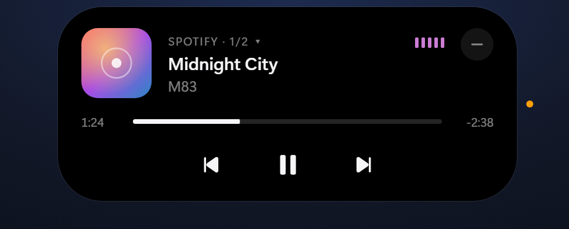
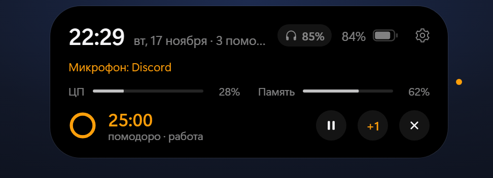

<div align="center">

# Dynamic Island для Windows

**Лёгкая, нативная «пилюля» сверху экрана в стиле iPhone для Windows 10 и 11.**  
Работает поверх всех окон, пропускает клики сквозь себя в свёрнутом виде и построена на **Tauri 2 + Rust + Win32/WinRT** с пружинной физикой на 60 FPS.

[](https://github.com/raiyaxkrash/dynamic-island/releases/latest)
[](https://tauri.app/)
[](https://www.rust-lang.org/)
[](https://github.com/raiyaxkrash/dynamic-island/releases/latest)

<h3>

[⬇️ Скачать установщик (`Dynamic-Island-0.1.0-x64-setup.exe`)](https://github.com/raiyaxkrash/dynamic-island/releases/latest)

</h3>

</div>

---

## Интерфейс

<div align="center">

| Плеер с адаптивным эквалайзером | Домашний экран, помодоро и система |
| :---: | :---: |
|  |  |

| Свёрнутый режим и точки приватности | Подключение Bluetooth-наушников |
| :---: | :---: |
|  |  |

</div>

<details>
<summary><b>Окно настроек</b></summary>

<div align="center">
<br>

</div>

</details>

---

## Возможности

- **Музыка и медиа (Windows GSMTC).** Работает со Spotify, Яндекс Музыкой, YouTube и музыкой в браузерах, «Медиаплеером» и любыми приложениями с системным медиа-контролем. Обложка масштабируется на стороне Rust (WIC `128×128`), а цвет эквалайзера автоматически подстраивается под её оттенки.
- **Несколько источников звука.** Если открыто несколько плееров (например, Spotify и видео в браузере), в плеере появляется переключатель `Источник · 1/2 ▾`.
- **Управление и перемотка.** Полоску прогресса можно нажимать и перетягивать; кнопка `−` сворачивает плеер к часам, а при смене трека он раскрывается коротким превью.
- **Таймер, свой интервал и помодоро.** Пресеты `5 мин`, `15 мин`, `Помодоро 25`, выбор произвольного времени (`1–180 мин`), `+1 мин` на лету, перерывы и 30-дневная статистика в настройках (сегодня, за 7 дней и серия дней).
- **Микрофон и камера.** Оранжевая и зелёная точки справа от острова при обращении программ к микрофону или камере; при наведении отображается конкретное приложение, а клик открывает параметры конфиденциальности Windows.
- **Буфер обмена.** Краткая подсказка при копировании текста, изображения или файлов. Контент с флагами приватности менеджеров паролей (`ExcludeClipboardContentFromMonitorProcessing`, `CanIncludeInClipboardHistory = 0`) не читается.
- **Наушники и заряд Bluetooth.** При подключении показывает название и тип устройства и, если Windows сообщает уровень батареи, кольцо заряда; текущее устройство и заряд также отображаются компактным чипом на домашнем экране.
- **Раскладка и Caps Lock.** Показывает смену языка (`РУ`, `EN` и др., включая `Win + Space`) и состояние `Caps Lock`.
- **Загрузка системы и батарея.** Полоски ЦП и памяти (с подсветкой от 85%), индикатор заряда, подключение питания и предупреждения на 20% и 10%.
- **Не мешает работе.** Над развёрнутым окном остров ужимается в тонкую полоску (`sliver`), чтобы не перекрывать вкладки браузера, в полноэкранных играх и видео прячется, не забирает фокус у активного окна и поддерживает перенос за курсором между мониторами с учётом смешанного DPI и верхней панели задач.
- **Событийный бэкенд.** Медиа (`GSMTC`), громкость и устройства (`Core Audio`), питание (`RegisterPowerSettingNotification`), буфер обмена (`AddClipboardFormatListener`) и доступ к камере/микрофону (`RegNotifyChangeKeyValue`) работают по системным событиям Windows.

---

## Горячие клавиши и жесты

| Действие | Управление |
| --- | --- |
| Раскрыть / свернуть остров | `Ctrl + Alt + I` *(или наведение курсора)* |
| Запустить Помодоро 25 / пауза таймера | `Ctrl + Alt + T` |
| Изменить громкость | Колёсико мыши над раскрытым островом *(опционально — и над свёрнутым)* |
| Следующий / предыдущий трек | Горизонтальный свайп двумя пальцами по тачпаду |
| Пауза / воспроизведение | Двойной клик по обложке или названию трека |
| Настройка своего таймера | Колёсико мыши или кнопки `−` / `+` в режиме таймера |

---

## Сборка из исходников

Требуются **Node.js 20+** и **Rust** (stable toolchain на Windows).

```bash
npm install
npm run dev      # запуск в режиме разработки
npm run build    # релизная сборка и NSIS-установщик в src-tauri/target/release/bundle/nsis
```

Проверка фронтенда и тестов Rust:

```bash
node --check ui/island.js
cargo test --manifest-path src-tauri/Cargo.toml
```

---

## Архитектура проекта

- `src-tauri/src/lib.rs` — инициализация Tauri, трей, окна, команды IPC и ротируемое логирование (`island.log`).
- `src-tauri/src/media.rs` — событийный GSMTC, переключение сессий и даунскейл обложек через Windows WIC.
- `src-tauri/src/audio.rs` — Core Audio (`IMMNotificationClient`, `IAudioEndpointVolumeCallback`) и единый поток регулировки громкости.
- `src-tauri/src/devices.rs` — чтение заряда Bluetooth-устройств через `SetupAPI`.
- `src-tauri/src/hover.rs` — прозрачность для кликов, сжатие в полоску над окнами, многомониторность и полноэкранный режим.
- `src-tauri/src/clipboard.rs` — `AddClipboardFormatListener` с проверкой приватности.
- `src-tauri/src/privacy.rs` — `RegNotifyChangeKeyValue` для микрофона и камеры.
- `src-tauri/src/power.rs` — `RegisterPowerSettingNotification` для батареи и питания.
- `src-tauri/src/keyboard.rs` — отслеживание раскладки и `Caps Lock`.
- `src-tauri/src/hotkeys.rs` — глобальные горячие клавиши `RegisterHotKey`.
- `src-tauri/src/settings.rs` — настройки, автозапуск в реестре и 30-дневная история помодоро.
- `src-tauri/src/sysinfo.rs` — загрузка ЦП/ОЗУ и полуночный сброс счётчика.
- `src-tauri/src/winmsg.rs` — общий помощник скрытых `HWND_MESSAGE`-окон.
- `ui/` — интерфейс острова (`index.html`, `island.css`, `island.js`) и окно настроек (`settings.html`).
