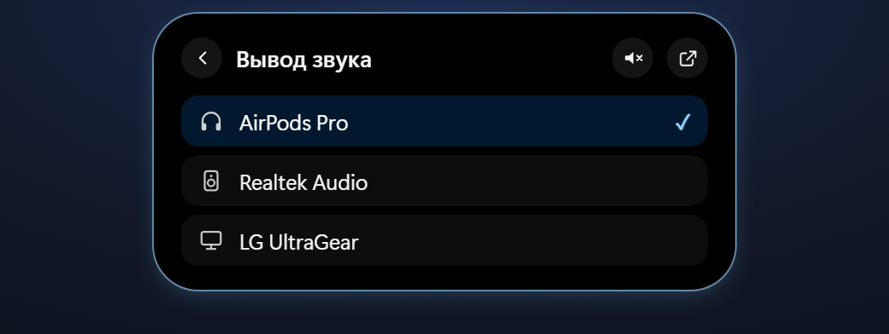
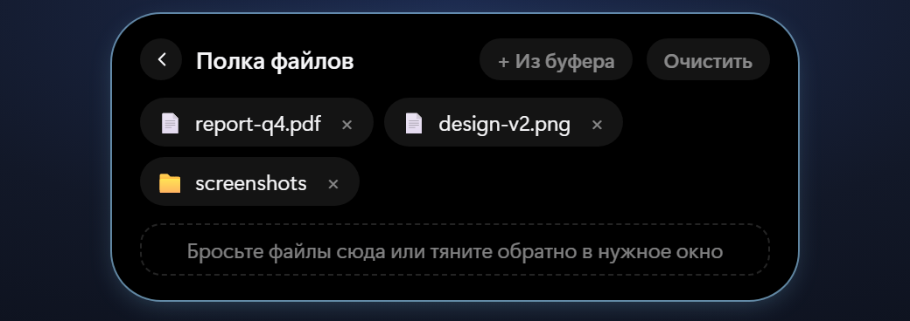

<div align="center">

# Dynamic Island для Windows

**Лёгкая, нативная «пилюля» сверху экрана в стиле iPhone для Windows 10 и 11.**  
Работает поверх всех окон, пропускает клики сквозь себя в свёрнутом виде и построена на **Tauri 2 + Rust + Win32/WinRT** с пружинной физикой на 60 FPS.

[](https://github.com/raiyaxkrash/dynamic-island/releases/latest)
[](https://tauri.app/)
[](https://www.rust-lang.org/)
[](LICENSE)
[](https://github.com/raiyaxkrash/dynamic-island/releases/latest)

<h3>

[⬇️ Скачать установщик (`Dynamic-Island-0.3.0-x64-setup.exe`)](https://github.com/raiyaxkrash/dynamic-island/releases/latest)

</h3>

> **Примечание о Windows SmartScreen:** установщик пока не подписан сертификатом (Authenticode), поэтому при первом запуске Windows может показать предупреждение «Система Windows защитила ваш компьютер» — нажмите **Подробнее → Выполнить в любом случае** (либо соберите из исходников командами ниже).

</div>

---

## Интерфейс

<div align="center">

| Плеер с адаптивным эквалайзером и свечением | Домашний экран, помодоро и система |
| :---: | :---: |
|  |  |

| Переключатель вывода звука и Mute | Полка файлов (Drag & Drop + из буфера) |
| :---: | :---: |
|  |  |

| Быстрая история буфера обмена (в ОЗУ) | Подключение Bluetooth-наушников |
| :---: | :---: |
|  |  |

| Свёрнутый режим и точки приватности |
| :---: |
|  |

</div>

<details>
<summary><b>Окно настроек (v0.3.0)</b></summary>

<div align="center">
<br>

</div>

</details>

---

## Возможности

- **Музыка и медиа (Windows GSMTC).** Работает со Spotify, Яндекс Музыкой, Apple Music, Tidal, Deezer, YouTube в браузерах (Chrome, Edge, Firefox, Brave, Arc, Zen, Vivaldi), PotPlayer, mpv и любыми приложениями с системным медиа-контролем. Обложка масштабируется в Rust (WIC `128×128`), цвет эквалайзера и свечения рамки подстраивается под её палитру, а между несколькими активными плеерами можно переключаться прямо из карточки трека.
- **Переключатель вывода звука и быстрый Mute.** Клик по чипу наушников/динамиков открывает список активных аудиоустройств и переключает вывод по умолчанию в 1 клик (`IPolicyConfig`), а средняя кнопка мыши по острову (или кнопка в панели звука) мгновенно включает/выключает Mute.
- **Полка файлов (Drag & Drop + сохранение).** Перетащите файлы на раскрытый остров или нажмите `+ Из буфера` (`CF_HDROP`), чтобы держать их под рукой между перезапусками (`shelf.json`), показать в Проводнике по клику (`SHOpenFolderAndSelectItems`) или вытянуть обратно в любое окно через нативный Windows OLE `DoDragDrop`.
- **Быстрая история буфера обмена (только в ОЗУ).** Хранит до 6 последних скопированных текстовых фрагментов исключительно в оперативной памяти для вставки в 1 клик. Данные с флагами приватности менеджеров паролей (`ExcludeClipboardContentFromMonitorProcessing`, `CanIncludeInClipboardHistory = 0`) игнорируются и не сохраняются на диск.
- **Таймер, свой интервал, помодоро и тихий режим.** Пресеты `5 мин`, `15 мин`, `Помодоро 25`, свой таймер (`1–180 мин`), `+1 мин` на лету, сохранение активного отсчёта при перезапуске, кнопка «Тихий режим» (🌙), автоприглушение второстепенных уведомлений во время фокус-сессии и 30-дневная статистика.
- **Микрофон и камера.** Оранжевая и зелёная точки справа от острова при обращении программ к микрофону или камере; на домашнем экране показывается само приложение, а клик открывает параметры конфиденциальности Windows.
- **Наушники и заряд Bluetooth.** При подключении показывает название и тип устройства и, если Windows сообщает уровень батареи, кольцо заряда; подробные подсказки показывают остаток времени работы ноутбука и занятую память в ГБ.
- **Раскладка и Caps Lock.** Отслеживает смену языка (`РУ`, `EN`, `DE`, `FR`, `ES`, `IT`, `PT`, `PL`, `TR`, `JA`, `KO`, `ZH`, `HE`, `AR` и др., включая `Win + Space`) и состояние `Caps Lock`.
- **Гибкий внешний вид, локализация (RU / EN) и мультимониторность.** Три стиля обводки (`Тонкая`, `Свечение` под цвет обложки, `Без рамки`), автовыбор или ручное переключение языка (включая меню в системном трее), выбор монитора (Основной / За курсором с поддержкой смешанного DPI), выравнивание (Слева / По центру / Справа с точным определением перекрытия окон под островом), отступ сверху и запись своих горячих клавиш.
- **Проверка обновлений и событийный бэкенд.** Фоновая и ручная проверка свежих релизов на GitHub (`WinHttp` с таймаутами) с компактным индикатором `↑` на домашнем экране, а все системные наблюдатели (`GSMTC`, `Core Audio`, `RegisterPowerSettingNotification`, `AddClipboardFormatListener`, `RegNotifyChangeKeyValue`) работают по событиям Windows.

---

## Горячие клавиши и жесты

| Действие | Управление |
| --- | --- |
| Раскрыть / свернуть остров | `Ctrl + Alt + I` *(настраивается в параметрах или наведение курсора)* |
| Запустить Помодоро 25 / пауза таймера | `Ctrl + Alt + T` *(настраивается в параметрах)* |
| Изменить громкость | Колёсико мыши над раскрытым островом *(опционально — и над свёрнутым)* |
| Выключить / включить звук (Mute) | Средняя кнопка мыши по острову или кнопка в панели звука |
| Следующий / предыдущий трек | Горизонтальный свайп двумя пальцами по тачпаду |
| Пауза / воспроизведение | Двойной клик по обложке или названию трека |
| Показать файл с полки в Проводнике | Одиночный клик по файлу на полке *(перетаскивание — Drag & Drop)* |
| Настройка своего таймера | Колёсико мыши или кнопки `−` / `+` в режиме таймера |

---

## Сборка из исходников

Требуются **Node.js 20+** и **Rust** (stable toolchain на Windows).

```bash
npm install
npm run dev      # запуск в режиме разработки
npm run build    # релизная сборка и NSIS-установщик в src-tauri/target/release/bundle/nsis
```

Проверка фронтенда и тестов Rust:

```bash
node --check ui/i18n.js
node --check ui/island.js
cargo test --manifest-path src-tauri/Cargo.toml
```

---

## Архитектура проекта

- `src-tauri/src/lib.rs` — инициализация Tauri, локализованный трей, окна, команды IPC, размещение и ротируемое логирование (`island.log`).
- `src-tauri/src/media.rs` — событийный GSMTC, переключение сессий и даунскейл обложек через Windows WIC.
- `src-tauri/src/audio.rs` — Core Audio (`IMMNotificationClient`, `IAudioEndpointVolumeCallback`), переключение устройства вывода (`IPolicyConfig`), громкость и Mute.
- `src-tauri/src/shelf.rs` — сохраняемая полка файлов (`shelf.json`), показ в Проводнике (`SHOpenFolderAndSelectItems`) и нативное перетаскивание наружу через OLE `SHCreateDataObject` / `DoDragDrop`.
- `src-tauri/src/clipboard.rs` — `AddClipboardFormatListener` с проверкой приватности, RAM-история текста, запись в буфер и чтение `CF_HDROP`.
- `src-tauri/src/devices.rs` — чтение заряда Bluetooth-устройств через `SetupAPI`.
- `src-tauri/src/hover.rs` — прозрачность для кликов, точное определение окон под островом (`left`/`center`/`right`), многомониторность и полноэкранный режим.
- `src-tauri/src/privacy.rs` — `RegNotifyChangeKeyValue` для микрофона и камеры.
- `src-tauri/src/power.rs` — `RegisterPowerSettingNotification` для батареи, питания и оценки оставшегося времени.
- `src-tauri/src/keyboard.rs` — отслеживание раскладки и `Caps Lock`.
- `src-tauri/src/hotkeys.rs` — настраиваемые глобальные горячие клавиши `RegisterHotKey`.
- `src-tauri/src/settings.rs` — настройки, автозапуск в реестре, определение системного языка и 30-дневная история помодоро.
- `src-tauri/src/updater.rs` — проверка обновлений через GitHub Releases API (`WinHttp` с сетевыми таймаутами).
- `src-tauri/src/sysinfo.rs` — загрузка ЦП/ОЗУ (включая объём в ГБ) и полуночный сброс счётчика.
- `src-tauri/src/winmsg.rs` — общий помощник скрытых `HWND_MESSAGE`-окон.
- `ui/` — интерфейс острова (`index.html`, `island.css`, `island.js`), локализация (`i18n.js`) и окно настроек (`settings.html`).
